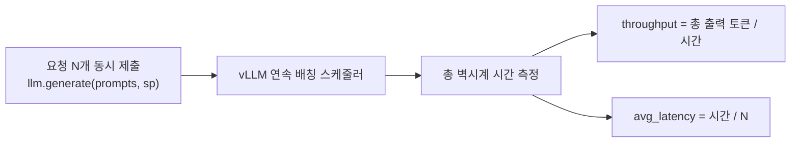
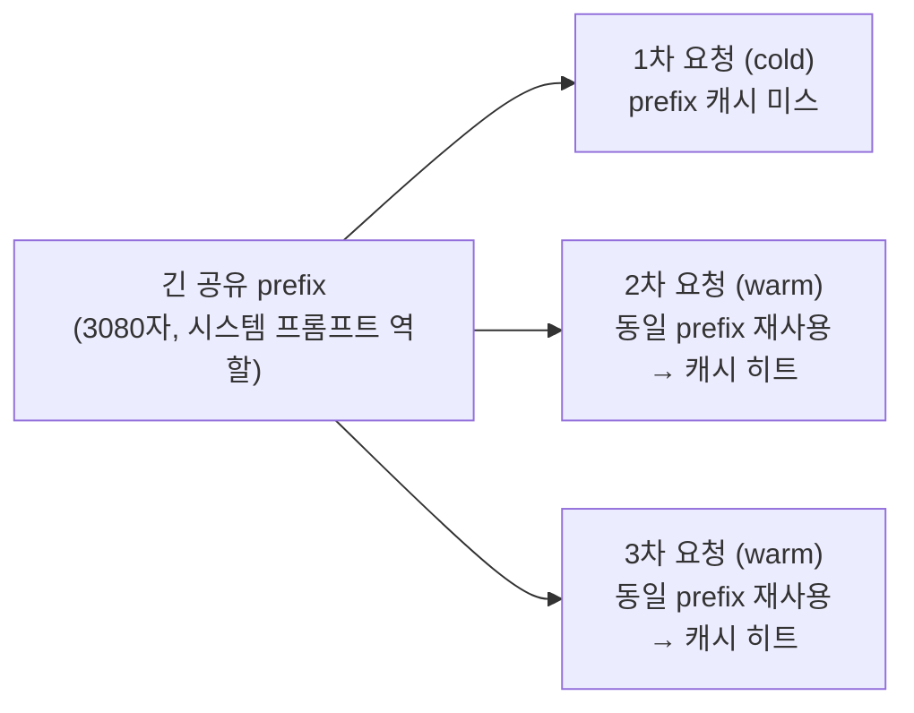
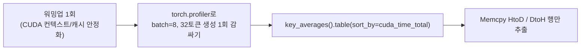

# vLLM 서빙 파라미터 튜닝 벤치마크

Colab T4 GPU에서 vLLM(TinyLlama-1.1B)을 직접 띄워 **동시성에 따른 연속 배칭(continuous batching) 처리량**, **Prefix Caching의 TTFT 단축 효과**, **GPU 커널 레벨 프로파일링(H2D/D2H 포함)**을 실측한 벤치마크입니다.

노트북: [`vllm_serving_tuning_benchmark.ipynb`](vllm_serving_tuning_benchmark.ipynb) (Colab에서 그대로 열어 재현 가능)

## 실험 1 — 동시성(batch size) vs 처리량/지연시간

`max_tokens=min_tokens=128`로 고정해 모든 요청이 동일한 길이를 생성하도록 강제(초기 실험에서 짧은 프롬프트가 1토큰 만에 EOS로 끝나 처리량 측정이 왜곡되는 문제를 발견하고 수정함 — 아래 "발견한 문제" 참고).

| n (동시 요청 수) | 총 시간 | 출력 토큰 | 처리량 (tok/s) | 요청당 평균 지연 |
|---|---|---|---|---|
| 1  | 2.03s | 128  | 63.2   | 2.027s |
| 2  | 1.54s | 256  | 166.8  | 0.768s |
| 4  | 1.48s | 512  | 345.3  | 0.371s |
| 8  | 1.56s | 1024 | 656.2  | 0.195s |
| 16 | 1.70s | 2048 | 1206.2 | 0.106s |
| 30 | 2.26s | 3840 | 1696.6 | 0.075s |

**핵심 관찰**: 동시 요청을 1개→30개(30배)로 늘려도 총 처리 시간은 2.03s→2.26s(1.1배)만 증가. 처리량은 63.2 → 1696.6 tok/s로 **약 26.8배** 증가하면서 요청당 평균 지연은 오히려 27배 감소(2.03s → 0.075s). vLLM의 연속 배칭이 GPU를 유휴 없이 채워 쓰기 때문 — 배치가 작을 때는 디코딩이 GEMV(memory-bandwidth-bound)라 GPU 연산 능력이 낭비되고, 배치를 키우면 같은 가중치 읽기를 여러 요청이 나눠 쓰면서 사실상 GEMM에 가까워짐.

### 발견한 문제: max_tokens만으로는 벤치마크가 왜곡됨
처음에는 `SamplingParams(temperature=0.0, max_tokens=128)`만 설정했는데, 결과가 `out_tokens == n`(요청마다 정확히 1토큰)으로 나왔습니다. 원인: TinyLlama-Chat 모델에 채팅 템플릿 없이 raw completion 프롬프트를 넣으면 모델이 즉시 EOS에 가까운 토큰을 생성해버려 거의 모든 요청이 1토큰 만에 종료됨 — 처리량이 아니라 요청 오버헤드만 재는 셈이 됨. `min_tokens=128`을 추가해 EOS를 무시하고 강제로 끝까지 생성하도록 고쳐서 실제 디코딩 처리량을 측정할 수 있었습니다.

## 실험 2 — Prefix Caching의 TTFT 단축 효과

`max_tokens=min_tokens=1`로 설정해 prefill(TTFT)만 격리 측정. 동일한 긴 prefix(3080자) + 서로 다른 질문을 3번 요청.

| 요청 | 시간 | 비고 |
|---|---|---|
| cold (캐시 미스) | 0.206s | prefix 전체를 처음부터 계산 |
| warm 1 (캐시 히트) | 0.125s | **1.65배** 빠름 |
| warm 2 (캐시 히트) | 0.135s | **1.53배** 빠름 |

TinyLlama-1.1B + 짧은 prefix 기준으로도 1.5~1.65배 단축을 확인. 더 큰 모델/더 긴 공유 prefix(예: RAG의 긴 시스템 프롬프트, few-shot 예시)일수록 이 효과는 훨씬 커짐 — prefill 연산량 자체가 스킵되기 때문.

## 실험 3 — GPU 프로파일링: H2D/D2H 복사가 실제로 병목인가?

`torch.profiler`로 `ProfilerActivity.CPU`+`CUDA`를 함께 켜고, batch=8·32토큰 생성 1회를 감싸서 커널별 Self CUDA 시간을 전부 뜯어봤습니다.

| 커널 | Self CUDA 시간 | 전체 대비 |
|---|---|---|
| `cutlass::Kernel2<...wmma_tensorop_f16...>` (GEMM) | 296.110ms | **85.7%** |
| **Memcpy HtoD (Pinned → Device)** | 132.223**μs** | 0.038% |
| **Memcpy DtoH (Device → Pinned)** | 89.789**μs** | 0.026% |
| Self CUDA 시간 합계 | 345.509ms | 100% |

**핵심 발견**: 이 설정(단일 GPU, batch=8, 짧은 시퀀스)에서는 H2D+D2H 복사 시간을 다 합쳐도 전체 GPU 시간의 **0.064%**밖에 안 됩니다 — GEMM 커널 하나(85.7%)에 비하면 사실상 무시할 수 있는 수준. `run_vllm_on_colab.ipynb`에서 찾은 GEMV 병목(실험 1의 배경)과 같은 결이지만, 이번엔 "H2D/D2H가 병목일 것"이라는 가설 자체를 직접 반증한 케이스입니다.

**왜 이런 결과가 나왔는가 (그리고 언제는 달라지는가)**: 이 벤치마크는 입출력이 전부 GPU 메모리 안에서 끝나는 단일 GPU·오프라인 배치라, 호스트↔디바이스 전송이 토큰 ID/샘플링 결과 같은 작은 텐서 몇 개뿐입니다. H2D/D2H가 실제로 유의미한 비중을 차지하는 상황은 오히려 (1) Prefill-Decode 분리 서빙에서 노드 간 KV 캐시 전송, (2) CPU 오프로딩(KV cache나 가중치를 CPU로 내렸다 올리는 경우), (3) 멀티모달 입력(이미지 텐서를 매 요청마다 새로 업로드)처럼 **호스트-디바이스 경계를 실제로 넘나드는 아키텍처**일 때입니다 — 이런 경우엔 이번 실험과 반대로 동기화 구간 자체가 병목이 될 수 있어, 프로파일링 없이 "H2D/D2H가 문제"라고 짐작하는 것과 실제로 숫자를 재보는 것의 차이를 보여주는 사례로 남겨뒀습니다.

## 재현 방법
1. Colab에서 [`vllm_serving_tuning_benchmark.ipynb`](vllm_serving_tuning_benchmark.ipynb) 열기
2. 런타임 > 런타임 유형 변경 > **T4 GPU**
3. 위에서부터 순서대로 실행 (vLLM 설치에 3~5분 소요)
