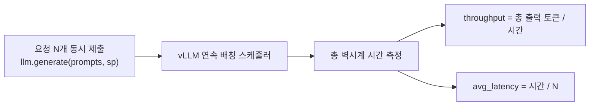
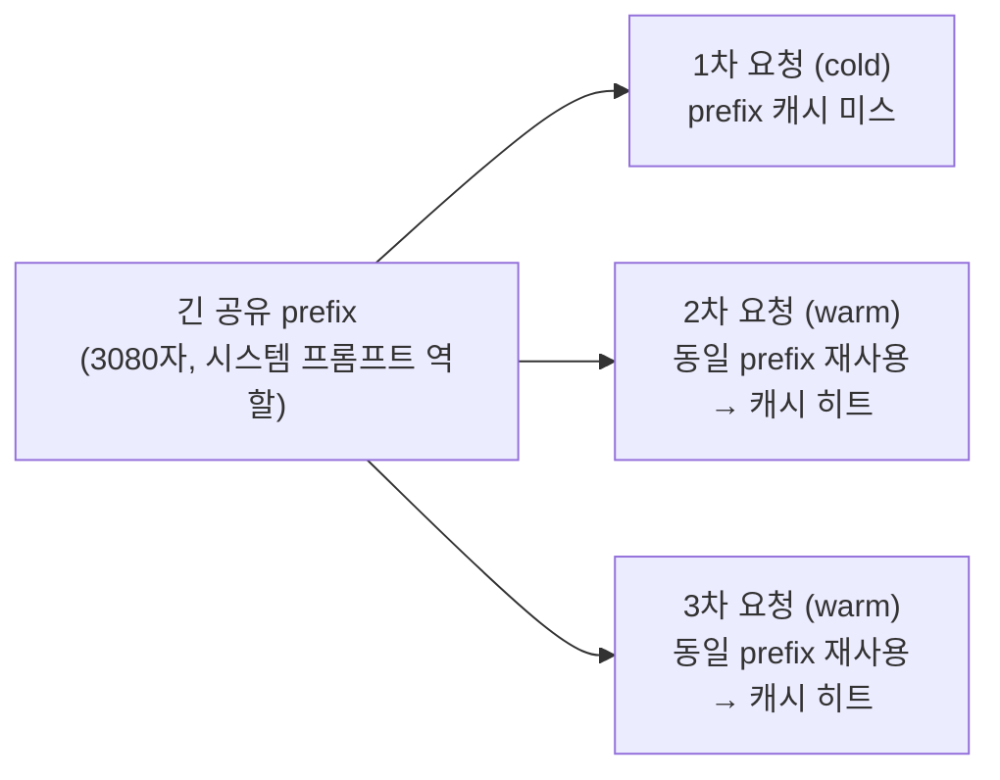
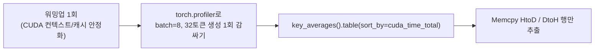
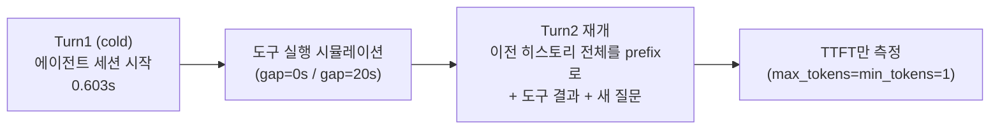
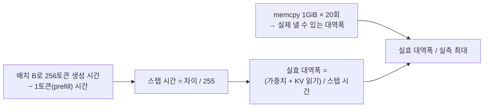

# vLLM 서빙 파라미터 튜닝 벤치마크

Colab T4 GPU에서 vLLM(TinyLlama-1.1B)을 직접 띄워 **동시성에 따른 연속 배칭(continuous batching) 처리량**, **Prefix Caching의 TTFT 단축 효과**, **GPU 커널 레벨 프로파일링(H2D/D2H 포함)**을 실측한 벤치마크입니다. 실험 5는 로컬 RTX 3060 Ti에서 **디코드의 메모리 대역폭 활용률과 CUDA graph 효과**를 쟀습니다.

노트북: [`vllm_serving_tuning_benchmark.ipynb`](vllm_serving_tuning_benchmark.ipynb) (Colab에서 그대로 열어 재현 가능)

## 실험 1 — 동시성(batch size) vs 처리량/지연시간

`max_tokens=min_tokens=128`로 고정해 모든 요청이 동일한 길이를 생성하도록 강제(초기 실험에서 짧은 프롬프트가 1토큰 만에 EOS로 끝나 처리량 측정이 왜곡되는 문제를 발견하고 수정함 — 아래 "발견한 문제" 참고).

| n (동시 요청 수) | 총 시간 | 출력 토큰 | 처리량 (tok/s) | 요청당 평균 지연 |
|---|---|---|---|---|
| 1  | 2.03s | 128  | 63.2   | 2.027s |
| 2  | 1.54s | 256  | 166.8  | 0.768s |
| 4  | 1.48s | 512  | 345.3  | 0.371s |
| 8  | 1.56s | 1024 | 656.2  | 0.195s |
| 16 | 1.70s | 2048 | 1206.2 | 0.106s |
| 30 | 2.26s | 3840 | 1696.6 | 0.075s |

**핵심 관찰**: 동시 요청을 1개→30개(30배)로 늘려도 총 처리 시간은 2.03s→2.26s(1.1배)만 증가. 처리량은 63.2 → 1696.6 tok/s로 **약 26.8배** 증가하면서 요청당 평균 지연은 오히려 27배 감소(2.03s → 0.075s). vLLM의 연속 배칭이 GPU를 유휴 없이 채워 쓰기 때문 — 배치가 작을 때는 디코딩이 GEMV(memory-bandwidth-bound)라 GPU 연산 능력이 낭비되고, 배치를 키우면 같은 가중치 읽기를 여러 요청이 나눠 쓰면서 사실상 GEMM에 가까워짐.

### RTX 3060 Ti 재측정 ([`continuous_batching/`](continuous_batching/))

위 T4 표와 같은 코드(노트북 셀 3~5의 `LLM(...)`, `SamplingParams`, 프롬프트 30개, `run_batch`)를 [`exp1.py`](continuous_batching/exp1.py)로 옮겨 로컬 GPU에서 다시 쟀습니다.
노트북의 n 루프를 한 프로세스 안에서 5번 반복했고, 표는 5회 중앙값입니다.

- 환경: RTX 3060 Ti 8GB, 드라이버 581.80(CUDA 13.0), WSL2 Ubuntu 22.04, vLLM 0.11.2 + torch 2.9.0+cu128 (pip venv). `VLLM_ENABLE_V1_MULTIPROCESSING=0`은 노트북과 같습니다.
- 모델: `TinyLlama/TinyLlama-1.1B-Chat-v1.0` revision `fe8a4ea1ffedaf415f4da2f062534de366a451e6`. dtype을 지정하지 않았고, 이 GPU에서는 bf16 커널(`__nv_bfloat16`)로 실행됐습니다. T4 실행의 dtype은 기록이 없습니다.
- 노트북 셀 2의 libcudart 미리 로드(Colab 우회 코드)는 넣지 않았습니다.

| n | 총 시간 (중앙값) | 총 시간 5회 | 처리량 (중앙값) | 처리량 5회 | 총 시간 / n |
|---|---|---|---|---|---|
| 1 | 0.966s | 0.979, 0.968, 0.962, 0.963, 0.966 | 132.5 tok/s | 130.8, 132.2, 133.0, 133.0, 132.5 | 0.966s |
| 2 | 0.970s | 0.971, 0.973, 0.969, 0.967, 0.970 | 264.0 tok/s | 263.8, 263.1, 264.3, 264.8, 264.0 | 0.485s |
| 4 | 0.976s | 0.976, 0.972, 0.973, 0.976, 0.979 | 524.8 tok/s | 524.6, 526.8, 526.0, 524.8, 523.1 | 0.244s |
| 8 | 1.018s | 1.022, 1.017, 1.017, 1.018, 1.021 | 1,006.2 tok/s | 1002.0, 1006.5, 1006.7, 1006.2, 1003.2 | 0.127s |
| 16 | 1.074s | 1.075, 1.091, 1.074, 1.071, 1.073 | 1,907.1 tok/s | 1905.8, 1877.1, 1907.1, 1911.6, 1907.8 | 0.067s |
| 30 | 1.353s | 1.360, 1.353, 1.352, 1.366, 1.352 | 2,838.0 tok/s | 2824.3, 2838.0, 2841.3, 2810.7, 2839.4 | 0.045s |

| 비교 | T4 (기존 값) | RTX 3060 Ti (이번 값) |
|---|---|---|
| n=1 처리량 | 63.2 tok/s | 132.5 tok/s |
| n=30 처리량 | 1,696.6 tok/s | 2,838.0 tok/s |
| n=1 → 30 처리량 배율 | 26.8배 | 21.4배 |
| n=1 → 30 총 시간 배율 | 1.11배 (2.03 → 2.26s) | 1.40배 (0.966 → 1.353s) |

"총 시간 / n" 열은 노트북의 `avg_latency/req` 정의(전체 시간 ÷ 요청 수)를 그대로 쓴 값입니다. 요청 하나가 끝날 때까지 걸린 시간은 아닙니다.

**프로파일러로 본 디코드 스텝 (n=1, n=30)** — 원인 확인용이며 시간은 대표 수치가 아닙니다.

Nsight Systems(2023.2.3, 2025.6.3, 2026.3.2)는 이 WSL2 환경에서 CUDA API 호출만 기록하고 GPU 커널은 기록하지 않았습니다.
행렬곱 10번짜리 최소 예제에서도 `SKIPPED: … does not contain CUDA kernel data.`였고, 진단 메시지는 `CUDA hardware tracing is not supported on this system. A legacy (software instrumented) trace was collected instead.`였습니다. 원인은 확인하지 못했습니다.
그래서 vLLM 내장 torch.profiler(`VLLM_TORCH_PROFILER_DIR`, `llm.start_profile()`)로 측정한 `generate` 한 번을 잡았습니다.
스텝은 샘플링된 토큰을 호스트로 복사하는 `Memcpy DtoH`를 끝으로 나눴습니다([`prof_steps.py`](prof_steps.py), 결과 [`continuous_batching/results/`](continuous_batching/results/)).
트레이스의 DtoH 복사 수는 n=1, n=30 모두 128개로 생성 토큰 수(=스텝 수)와 같았습니다.

| | n=1 | n=30 |
|---|---|---|
| 스텝 수 (첫 스텝은 prefill 포함) | 128 | 128 |
| 디코드 스텝당 커널 수 | 299 (127스텝 모두) | 299 (127스텝 모두) |
| 디코드 스텝 GPU busy (중앙값) | 6.03ms | 8.02ms |
| 스텝 안 GPU 유휴 (중앙값) | 0.49ms | 1.20ms |
| 스텝 사이 GPU 유휴 (이전 DtoH 끝 → 다음 GPU 작업, 중앙값) | 1.26ms | 1.44ms |
| 프로파일러 켠 상태의 generate 시간 | 1.024s | 1.436s |

커널 시간 상위 5개 (측정한 generate 전체, 커널 시간 합 대비)
- n=1: `gemv2T_kernel_val<…bf16…, 128, 16, 4, 4…>` 45.4%, `cutlass … wmma_tensorop_bf16 … 16x16_128x2` 24.0%, `gemv2T_kernel_val<…, 128, 16, 2, 4…>` 20.1%, `flash_fwd_splitkv_kernel` 3.3%, `flash_fwd_splitkv_combine_kernel` 1.6%
- n=30: `cutlass … tensorop_bf16_s16816gemm_relu_bf16_128x64_32x6` 36.5%, `ampere_bf16_s16816gemm_bf16_128x64_ldg8_f2f_stages_64x4_tn` 25.6%, `ampere_bf16_s16816gemm_bf16_128x64_ldg8_f2f_stages_32x6_tn` 14.2%, `flash_fwd_splitkv_kernel` 8.2%, `ampere_bf16_s16816gemm_bf16_64x64_sliced1x2_ldg8_f2f_stages_64x6_tn` 6.8%

vLLM은 실행 중 `Using 'pin_memory=False' as WSL is detected. This may slow down the performance.` 경고를 냈고, 트레이스의 HtoD 복사는 모두 `Pageable -> Device`였습니다.

### 발견한 문제: max_tokens만으로는 벤치마크가 왜곡됨
처음에는 `SamplingParams(temperature=0.0, max_tokens=128)`만 설정했는데, 결과가 `out_tokens == n`(요청마다 정확히 1토큰)으로 나왔습니다. 원인: TinyLlama-Chat 모델에 채팅 템플릿 없이 raw completion 프롬프트를 넣으면 모델이 즉시 EOS에 가까운 토큰을 생성해버려 거의 모든 요청이 1토큰 만에 종료됨 — 처리량이 아니라 요청 오버헤드만 재는 셈이 됨. `min_tokens=128`을 추가해 EOS를 무시하고 강제로 끝까지 생성하도록 고쳐서 실제 디코딩 처리량을 측정할 수 있었습니다.

## 실험 2 — Prefix Caching의 TTFT 단축 효과

`max_tokens=min_tokens=1`로 설정해 prefill(TTFT)만 격리 측정. 동일한 긴 prefix(3080자) + 서로 다른 질문을 3번 요청.

| 요청 | 시간 | 비고 |
|---|---|---|
| cold (캐시 미스) | 0.206s | prefix 전체를 처음부터 계산 |
| warm 1 (캐시 히트) | 0.125s | **1.65배** 빠름 |
| warm 2 (캐시 히트) | 0.135s | **1.53배** 빠름 |

TinyLlama-1.1B + 짧은 prefix 기준으로도 1.5~1.65배 단축을 확인. 더 큰 모델/더 긴 공유 prefix(예: RAG의 긴 시스템 프롬프트, few-shot 예시)일수록 이 효과는 훨씬 커짐 — prefill 연산량 자체가 스킵되기 때문.

## 실험 3 — GPU 프로파일링: H2D/D2H 복사가 실제로 병목인가?

`torch.profiler`로 `ProfilerActivity.CPU`+`CUDA`를 함께 켜고, batch=8·32토큰 생성 1회를 감싸서 커널별 Self CUDA 시간을 전부 뜯어봤습니다.

| 커널 | Self CUDA 시간 | 전체 대비 |
|---|---|---|
| `cutlass::Kernel2<...wmma_tensorop_f16...>` (GEMM) | 296.110ms | **85.7%** |
| **Memcpy HtoD (Pinned → Device)** | 132.223**μs** | 0.038% |
| **Memcpy DtoH (Device → Pinned)** | 89.789**μs** | 0.026% |
| Self CUDA 시간 합계 | 345.509ms | 100% |

**핵심 발견**: 이 설정(단일 GPU, batch=8, 짧은 시퀀스)에서는 H2D+D2H 복사 시간을 다 합쳐도 전체 GPU 시간의 **0.064%**밖에 안 됩니다 — GEMM 커널 하나(85.7%)에 비하면 사실상 무시할 수 있는 수준. `run_vllm_on_colab.ipynb`에서 찾은 GEMV 병목(실험 1의 배경)과 같은 결이지만, 이번엔 "H2D/D2H가 병목일 것"이라는 가설 자체를 직접 반증한 케이스입니다.

**왜 이런 결과가 나왔는가 (그리고 언제는 달라지는가)**: 이 벤치마크는 입출력이 전부 GPU 메모리 안에서 끝나는 단일 GPU·오프라인 배치라, 호스트↔디바이스 전송이 토큰 ID/샘플링 결과 같은 작은 텐서 몇 개뿐입니다. H2D/D2H가 실제로 유의미한 비중을 차지하는 상황은 오히려 (1) Prefill-Decode 분리 서빙에서 노드 간 KV 캐시 전송, (2) CPU 오프로딩(KV cache나 가중치를 CPU로 내렸다 올리는 경우), (3) 멀티모달 입력(이미지 텐서를 매 요청마다 새로 업로드)처럼 **호스트-디바이스 경계를 실제로 넘나드는 아키텍처**일 때입니다 — 이런 경우엔 이번 실험과 반대로 동기화 구간 자체가 병목이 될 수 있어, 프로파일링 없이 "H2D/D2H가 문제"라고 짐작하는 것과 실제로 숫자를 재보는 것의 차이를 보여주는 사례로 남겨뒀습니다.

## 실험 4 — 에이전트형 멀티턴 패턴에서 Prefix Caching 유지 효과

실험 2가 "동일 시스템 프롬프트 + 다른 질문"이라는 고전적 RAG 캐싱 패턴을 테스트했다면, 이 실험은 **에이전트 루프 특유의 패턴**을 테스트합니다: 이전 턴의 전체 히스토리(모델 자신이 생성한 응답 포함)가 다음 턴 프롬프트의 prefix로 그대로 재사용되고, 그 사이에 도구 실행으로 인한 "멈춤(gap)"이 낀다는 점이 다릅니다.

| 조건 | TTFT | 콜드 대비 |
|---|---|---|
| Turn1 (cold, 세션 시작) — 전체 생성 | 0.603s | - |
| Turn2 재개, gap=0s | 0.121s | 1.11배 |
| Turn2 재개, gap=20s | 0.047s | **2.85배** |
| 완전 콜드(무관한 질문, 유사 길이) 기준 | 0.134s | - |

**핵심 발견**: 도구 실행 시간(gap)이 0초든 20초든, 재개 시 TTFT는 완전 콜드 기준보다 확실히 빠릅니다 — vLLM의 prefix caching이 경쟁 트래픽 없는 단일 세션 환경에서는 gap 길이와 무관하게 이전 턴의 KV 캐시를 그대로 들고 있다가 재사용한다는 뜻입니다. 이건 앞선 대화에서 얘기한 "에이전트가 도구를 실행하는 동안 멈춰도, 재개할 때 이전 히스토리 전체를 다시 계산할 필요가 없다"는 가설을 실측으로 확인한 것입니다.

**정직한 한계**: gap=20s가 gap=0s보다 오히려 더 빠르게 나온 것(1.11배 vs 2.85배)은 직관과 반대인데, 각 조건을 1회씩만 측정했기 때문에(0.1s 스케일에서의 측정 노이즈·GPU 워밍업 효과일 가능성이 높음) 이 격차 자체에 의미를 두면 안 됩니다 — 여러 번 반복 측정해 분산을 보는 게 정확하겠지만 이 실습에서는 하지 않았습니다. 또한 이 실험은 **경쟁 트래픽이 없는 단일 세션**만 테스트했습니다 — 실제 멀티테넌트 서버에서 도구 실행 중 다른 요청들이 GPU/KV 캐시를 채우면 이 에이전트 세션의 캐시가 밀려날 수 있는데(LRU eviction), 그 시나리오는 이번엔 검증하지 못했습니다. 이건 하이퍼엑셀 인터뷰 포트폴리오 노션 페이지의 "LPU 경쟁 구도" 문서에서 제안 방향으로만 남겨뒀습니다.

## 실험 5 — 디코드 한 스텝은 메모리 대역폭을 얼마나 쓰는가 (RTX 3060 Ti)

실험 1에서 "작은 배치의 디코드는 메모리 대역폭에 묶인다"고 설명했지만 숫자로 확인하지는 않았습니다. 이번에는 로컬 GPU(RTX 3060 Ti 8GB, vLLM 0.11.2)에서
디코드 한 스텝이 GPU 메모리 대역폭을 실제로 몇 % 쓰는지, 그리고 CUDA graph가 얼마나 차이를 내는지 쟀습니다.

- **기준 대역폭**: 사양상 448GB/s, GPU 안에서 1GiB 복사로 잰 실제 최대는 **349.1GB/s**(3회 348.1~351.6)입니다.
- **스텝당 읽는 바이트**: TinyLlama 설정에서 계산한 가중치 2.069GB(22개 레이어 + lm_head)와 KV 캐시(토큰당 22,528B × 배치 × 평균 문맥 160토큰)를 더했습니다.
  활성값과 샘플링은 빼서, 실제로 읽는 양보다 약간 적게 잡힙니다.
- **조건**: 무작위 32토큰 프롬프트, 출력 256토큰(`ignore_eos`), prefix caching 끔, 배치마다 3회 측정해 중앙값을 썼습니다.
  CUDA graph(기본값)와 `enforce_eager=True`를 각각 따로 실행했습니다.

| 배치 | 스텝(graph) | tok/s(graph) | 실효 대역폭(graph) | 스텝(eager) | 실효 대역폭(eager) |
|---|---|---|---|---|---|
| 1 | 9.10ms | 109.9 | 227.7GB/s (65%) | 14.42ms | 143.7GB/s (41%) |
| 2 | 9.26ms | 216.1 | 224.3GB/s (64%) | 15.85ms | 131.0GB/s (38%) |
| 4 | 9.18ms | 435.8 | 227.0GB/s (65%) | 16.40ms | 127.0GB/s (36%) |
| 8 | 9.67ms | 827.4 | 217.0GB/s (62%) | 15.86ms | 132.2GB/s (38%) |
| 16 | 9.74ms | 1,643.1 | 218.4GB/s (63%) | 17.09ms | 124.5GB/s (36%) |
| 32 | 12.02ms | 2,663.0 | 181.8GB/s (52%) | 16.72ms | 130.7GB/s (37%) |
| 64 | 13.26ms | 4,827.0 | 173.4GB/s (50%) | 16.70ms | 137.7GB/s (39%) |
| 128 | 19.69ms | 6,502.4 | 128.5GB/s (37%) | 21.11ms | 119.9GB/s (34%) |

괄호는 실측 최대 349.1GB/s 대비 비율입니다.

**핵심 발견**
1. **배치 1~16은 대역폭 구간입니다.** 스텝 시간이 9.10ms에서 9.74ms로 7%만 늘었는데, 처리량은 약 15배(109.9 → 1,643.1 tok/s)가 됐습니다.
   매 스텝 가중치 2.07GB를 한 번 읽는 비용이 지배하고, 그 읽기를 배치 안의 요청들이 나눠 씁니다. 실험 1의 설명을 처음으로 숫자로 확인했습니다.
2. **그래도 배치 1에서 대역폭의 65%만 씁니다.** 나머지 35%가 어디로 가는지는 이번에 분해하지 않았습니다.
   후보는 작은 GEMV 커널의 효율, 스텝 사이 스케줄러와 샘플링의 CPU 시간입니다. 스텝 시간에 이것들이 모두 들어 있어서, Nsight Systems로 타임라인을 봐야 나눌 수 있습니다.
3. **배치 32부터는 대역폭만으로 설명되지 않습니다.** 읽는 바이트는 2.18GB → 2.53GB로 16%만 늘었는데 스텝은 12.0ms → 19.7ms로 64% 늘었습니다. 연산 비중이 커지는 구간입니다.
4. **CUDA graph가 배치 1에서 스텝당 5.3ms(37%)를 줄입니다.** eager에서는 스텝 시간이 배치 1~64 내내 약 14~17ms로 평평합니다.
   GPU가 아니라 커널을 하나씩 띄우는 CPU 쪽 오버헤드에 묶여 있다는 뜻입니다. 배치 128에서는 차이가 7%(19.7 vs 21.1ms)로 줄어듭니다.

**의미**: 대화형 서빙처럼 배치가 작은 디코드에서는, 연산 성능보다 **메모리 대역폭을 얼마나 꽉 채우는지와 커널 실행 오버헤드를 얼마나 숨기는지**가 속도를 정합니다.
같은 GPU라도 CUDA graph 하나로 대역폭 활용률이 41%에서 65%로 바뀌었습니다.

**정직한 한계**
- 작은 모델(1.1B) 하나와 소비자용 GPU 하나의 결과입니다. 모델이 커지면 가중치 읽기 비중이 더 커져 그림이 달라질 수 있습니다.
- 바이트 모델은 근사치입니다(활성값·샘플링 제외). 스텝 시간에는 CPU 스케줄링 시간도 들어 있습니다.
- 반복은 배치당 3회입니다. eager 배치 1의 3회 범위가 14.0~16.1ms로 다른 칸보다 넓습니다.

코드와 원본: [`decode_bandwidth/`](decode_bandwidth/) — [`bw.py`](decode_bandwidth/bw.py)(측정), [`run.sh`](decode_bandwidth/run.sh)(k3s containerd에서 `vllm/vllm-openai:v0.11.2` 이미지로 실행), [`results/`](decode_bandwidth/results/)(JSON).

## 실험 6 — n-gram speculative decoding 켜기/끄기 (RTX 3060 Ti)

Qwen2.5-1.5B-Instruct(fp16), 배치 1, `temperature=0`, `max_tokens=min_tokens=256`, 프롬프트마다 5회.
`speculative_config={"method": "ngram", "num_speculative_tokens": 4, "prompt_lookup_max": 4, "prompt_lookup_min": 2}`.
설정 키 확인 위치, 매회 값, 프로파일러 결과는 [`spec_decode/README.md`](spec_decode/README.md)에 있습니다.

| 워크로드 | off (tok/s, 중앙값) | ngram (tok/s, 중앙값) | 배율 | 수락률 | greedy 출력 동일 |
|---|---|---|---|---|---|
| 복사 (코드 파일 다시 쓰기) | 98.3 | 396.5 | 4.03배 | 96.2% | 예 |
| 대화 1 | 98.8 | 93.8 | 0.95배 | 14.1% | 예 |
| 대화 2 | 98.7 | 103.3 | 1.05배 | 21.5% | 예 |
| 대화 3 | 98.6 | 95.4 | 0.97배 | 15.5% | 예 |

`VLLM_ENABLE_V1_MULTIPROCESSING=0`(실험 1 노트북 설정)에서는 n-gram proposer가 매 스텝 draft를 만들었지만 스케줄러 카운터가 0이었고 속도도 off보다 느렸습니다. 원인은 확인하지 못했고, 위 표는 기본값(1)으로 쟀습니다.

## 재현 방법
실험 1~4는 Colab, 실험 5는 로컬 GPU에서 `decode_bandwidth/run.sh`로 실행했습니다.
실험 1의 RTX 3060 Ti 재측정과 실험 6은 WSL2의 pip venv(vLLM 0.11.2)에서 `continuous_batching/exp1.py`, `spec_decode/spec.py`로 실행했습니다.

1. Colab에서 [`vllm_serving_tuning_benchmark.ipynb`](vllm_serving_tuning_benchmark.ipynb) 열기
2. 런타임 > 런타임 유형 변경 > **T4 GPU**
3. 위에서부터 순서대로 실행 (vLLM 설치에 3~5분 소요)
